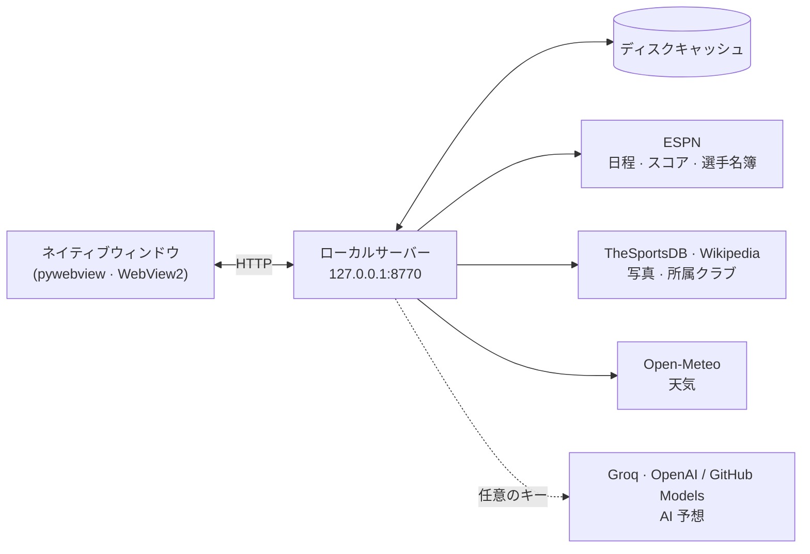

<p align="right"><a href="README.md">English</a> · <a href="README.ko.md">한국어</a> · <a href="README.zh.md">中文</a> · <b>日本語</b></p>

# World Cup Pilot

**独自の予測エンジンを備えた FIFA ワールドカップのデスクトップビューア。** 無料の公開ソースから日程・結果・順位・対戦表・選手・動画を表示し、**Elo × Score 予測**、**AI 予測**、**予測精度の比較**も提供します。**歴代ワールドカップ（1930〜2026）** を大会ごとに閲覧できます。Windows 専用。

> **非公式のファンプロジェクトです。** FIFA、ESPN、その他のデータ提供元とは提携・後援・関係がありません。「FIFA」「World Cup」の権利はそれぞれの所有者に帰属します。このリポジトリには第三者のデータ・写真・ロゴは含まれておらず、すべてご自身の PC で初回起動時にダウンロードされます。個人利用向けで、商用配布を目的としません。

## 機能

| 領域 | 内容 |
|---|---|
| **日程・結果** | 全試合のライブスコア、現地時間、イベント（ゴール・カード）、スタッツ、ラインナップ |
| **グループ** | リアルタイムのグループ順位、突破マーク、2026 年方式（各組上位 2 チーム＋3 位の上位 8 チーム） |
| **予測** | 各試合の勝/分/敗の確率と予想スコア（🔮 Elo × Score） |
| **AI 予測** | ⚡ Groq（Llama 3.3）と 💬 ChatGPT の予想（任意） |
| **予測成績** | Elo × Score、DraftKings オッズ、Groq、ChatGPT の 4 つを実際の結果で採点 |
| **ラインナップ** | 発表前は予想先発 XI、発表後は実際の先発 XI とフォーメーション |
| **歴代大会** | 大会を選ぶと、選手・年齢・ランキングは当時の情報で表示 |
| **UI** | ダーク/ライトテーマ、4 言語、デスクトップ通知、タスクバーの LIVE バッジ |

## 仕組み



もう変わらないデータ（終了した試合、過去の大会）は永久にキャッシュし、ライブデータは変わりうるときだけ取得するため、アプリは軽快で、無料サービスへの負担も抑えられます。

## データソース

任意の AI 予測を除き、すべて無料でキーは不要です。

| データ | ソース |
|---|---|
| 日程・スコア・順位・対戦表・チーム・オッズ・選手名簿 | ESPN |
| 選手の写真・所属クラブ | TheSportsDB、失敗時は Wikipedia |
| 国旗 | flagcdn |
| スタジアム画像・過去大会のエンブレム | Wikipedia |
| 気温・湿度・風速 | Open-Meteo |
| ハイライト動画 | YouTube（FIFA 公式チャンネルを優先） |
| AI 予測 | Groq（無料キー）、OpenAI または GitHub Models（任意） |

## 予測（🔮 Elo × Score）

キックオフ前に分かる情報だけを使います。重みは UI のスライダーで調整できます。

| 要素 | 反映のしかた |
|---|---|
| **Elo** | FIFA ランキングを初期値とし、大会の結果で更新 |
| **直近のフォーム** | 攻撃・中盤・守備・GK の 4 指標、直近の試合ほど重みが大きい |
| **負傷・出場停止** | 選手の評価で重み付けし、主力の欠場ほど戦力が大きく下がる |
| **FIFA のカード規則** | 警告 2 枚で 1 試合停止、レッドは停止、警告 1 枚は準々決勝終了後に消滅 |
| **実際のラインナップ** | 先発 XI の発表後、実際の出場選手に合わせて戦力を補正 |
| **ホーム・休養・移動・天気** | ホームの利、休養日数、移動距離、天気 |

**自己チューニング：** ↻ ボタンが 9 大会の実際の結果でモデルの形状をグリッドサーチし、`model_params.json` に保存します。新しい結果があるときだけ再チューニングします。

## ダウンロード

**[Releases](https://github.com/dongliquan/WorldCup_Pilot/releases/latest)** から `WorldCupPilot.exe` を入手してください。Windows 10/11 と Edge WebView2 ランタイムが必要です。

exe にはコード署名がないため、Windows SmartScreen の警告が表示されます。**詳細情報 → 実行**をクリックしてください。初回起動は必要なデータをダウンロードするため遅く、2 回目以降は速くなります。

## ソースから実行

```bash
python -m venv .venv
.venv\Scripts\pip install -r requirements.txt
.venv\Scripts\python worldcup.py        # デスクトップウィンドウ
python server.py                        # サーバーのみ: http://127.0.0.1:8770
pyinstaller --noconfirm worldcup_win.spec   # dist\WorldCupPilot.exe をビルド
```

## 設定（`config.json`）

`config.example.json` を `config.json` にコピーしてください。**AI キーは任意**で、なくても Elo × Score と DraftKings の予測は動作します。`config.json` は git の対象外です。キーは絶対にコミットしないでください。

| キー | 意味 |
|---|---|
| `groq_api_key` | `console.groq.com` の無料キー（`gsk_…`） |
| `openai_api_key` | OpenAI キー（`sk-…`）、または無料の GitHub Models 用 GitHub トークン（`ghp_…`） |
| `competition`, `season` | 既定は `WC`、`2026` |
| `cache_ttl_seconds` | ライブデータ用の短いキャッシュ（既定 60）。静的データ・終了試合・予測は永久キャッシュ |
| `venue_timezone` | 代替タイムゾーン、既定は `America/New_York` |

キーを変更したらアプリを再起動してください。

## ローカル API

`GET`: `/api/status` · `/api/matches[?year=]` · `/api/standings[?year=]` · `/api/team?id=` · `/api/match?id=` · `/api/predict?id=` · `/api/lineup?id=` · `/api/aipick?id=&p=groq|openai` · `/api/accuracy` · `/api/model-params`
`POST`: `/api/refresh`（データの再検証とモデルの再チューニング）· `/api/grade-ai` · `/api/save-edition?year=`

## プロジェクト構成

| ファイル | 役割 |
|---|---|
| `worldcup.py` | ランチャー：サーバースレッドとネイティブウィンドウを起動し、通知とタスクバーのバッジを扱う |
| `server.py` | ローカルサーバー：各ソースの中継・正規化、キャッシュ、予測、チューニング |
| `worldcup.html` | シングルページの UI |
| `assets/` | 静的データ（ランキング、国情報、スタジアム、大会情報）とアプリアイコン |
| `test_model_consistency.py` | UI・サーバー・チューニングスクリプトで予測の計算式が一致しているか検査 |
| `worldcup_win.spec` | Windows 単一 exe 用の PyInstaller ビルド |

## 既知の制限

- Windows 専用で、exe は署名されていません。
- 無料ソースには呼び出し制限があり（特に TheSportsDB）、写真は少しずつ補われます。
- データは非公式の公開エンドポイントから取得するため、予告なく変更・消滅する可能性があります。

## プライバシーとセキュリティ

テレメトリはありません。サーバーは `127.0.0.1` だけで待ち受けます。アプリは上記の公開サービスをお使いの PC から直接呼び出し、AI キーはローカルの `config.json` にのみ保存され、対応する AI 提供元にだけ送信されます。脆弱性は GitHub の *Report a vulnerability* から非公開で報告してください（[SECURITY.md](SECURITY.md) を参照）。

## ライセンス

[MIT](LICENSE) © dongliquan
