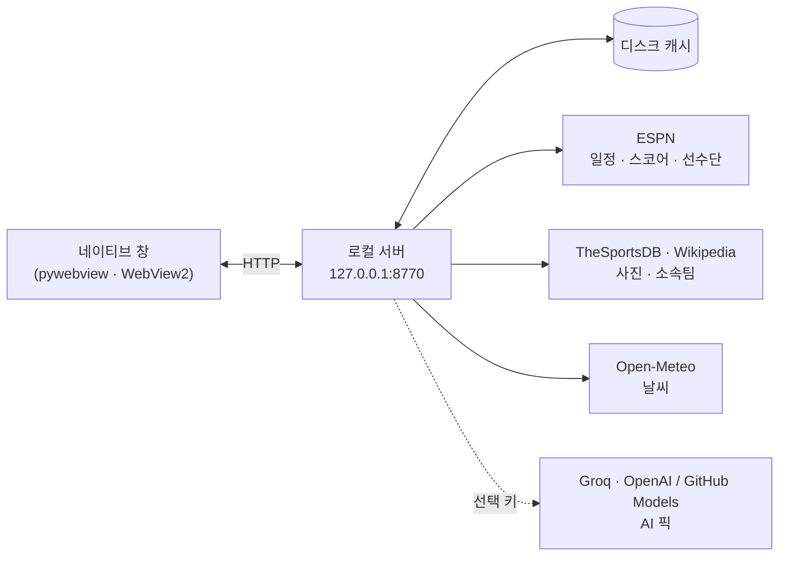

<p align="right"><a href="README.md">English</a> · <b>한국어</b> · <a href="README.zh.md">中文</a> · <a href="README.ja.md">日本語</a></p>

# World Cup Pilot

**자체 예측 엔진이 있는 FIFA 월드컵 데스크톱 뷰어.** 무료 공개 소스로 일정·결과·순위·대진·선수·영상을 보여 주고, **Elo × Score 예측**, **AI 예측**, **예측 정확도 비교**까지 제공합니다. **역대 월드컵(1930~2026)** 을 회차별로 볼 수 있습니다. Windows 전용.

> **비공식 팬 프로젝트입니다.** FIFA, ESPN 및 어떤 데이터 제공처와도 제휴·후원·연관이 없습니다. "FIFA"와 "World Cup"의 권리는 각 소유자에게 있습니다. 이 저장소에는 외부 데이터·사진·로고가 들어 있지 않고, 모두 내 PC에서 처음 실행할 때 내려받습니다. 개인용이며 상용 배포용이 아닙니다.

## 기능

| 영역 | 내용 |
|---|---|
| **일정·결과** | 전 경기 라이브 스코어, 현지 시간, 이벤트(골·카드), 스탯, 라인업 |
| **조별** | 실시간 조 순위, 진출 표시, 2026 포맷(조 1·2위 + 3위 중 상위 8팀) |
| **예측** | 경기마다 승/무/패 확률과 예상 스코어(🔮 Elo × Score) |
| **AI 예측** | ⚡ Groq(Llama 3.3), 💬 ChatGPT 픽(선택) |
| **예측성적** | Elo × Score · DraftKings 배당 · Groq · ChatGPT 4개 예측기를 실제 결과로 채점 |
| **라인업** | 공시 전 예상 XI, 공시 후 실제 XI와 포메이션 |
| **역대 대회** | 회차를 고르면 당시 선수·나이·랭킹·결과 기준으로 표시 |
| **UI** | 다크/라이트, 4개 국어, 데스크톱 알림, 작업표시줄 LIVE 뱃지 |

## 동작 방식



더 이상 바뀌지 않는 데이터(끝난 경기, 지난 대회)는 영구 캐시하고, 라이브 데이터는 바뀔 수 있을 때만 요청하므로 앱이 빠르고 무료 서비스에도 부담을 덜 줍니다.

## 데이터 소스

선택 사항인 AI 예측을 빼면 전부 무료이고 키가 필요 없습니다.

| 데이터 | 소스 |
|---|---|
| 일정·스코어·순위·대진·팀·배당·선수단 | ESPN |
| 선수 사진·소속팀 | TheSportsDB, 실패 시 Wikipedia |
| 국기 | flagcdn |
| 경기장 이미지·과거 대회 엠블럼 | Wikipedia |
| 온도·습도·풍속 | Open-Meteo |
| 하이라이트 영상 | YouTube(공식 FIFA 채널 우선) |
| AI 예측 | Groq(무료 키), OpenAI 또는 GitHub Models(선택) |

## 예측 (🔮 Elo × Score)

킥오프 전에 알 수 있는 정보만 사용합니다. 가중치는 UI 슬라이더로 조정할 수 있습니다.

| 요소 | 반영 방식 |
|---|---|
| **Elo** | FIFA 랭킹으로 시작해 대회 결과로 갱신 |
| **최근 폼** | 공격·미드필드·수비·골키퍼 4지표, 최근 경기 가중 |
| **부상·출전정지** | 선수 평점으로 가중해 핵심 선수 결장일수록 더 크게 약화 |
| **FIFA 카드 규칙** | 경고 2장이면 1경기 정지, 레드는 정지, 단일 경고는 8강 종료 후 소멸 |
| **실제 라인업** | 선발 XI가 공시되면 실제 출전 멤버로 전력 보정 |
| **홈·휴식·이동·날씨** | 홈 이점, 휴식일, 이동거리, 날씨 |

**자가 튜닝:** ↻ 버튼이 9개 월드컵의 실제 결과로 모델 모양을 그리드 서치해 `model_params.json` 에 저장합니다. 새 결과가 있을 때만 다시 튜닝합니다.

## 다운로드

**[Releases](https://github.com/dongliquan/WorldCup_Pilot/releases/latest)** 에서 `WorldCupPilot.exe` 를 받으세요. Windows 10/11과 Edge WebView2 런타임이 필요합니다.

exe는 코드 서명이 없어 Windows SmartScreen 경고가 뜹니다. **추가 정보 → 실행** 을 누르세요. 처음 실행할 때는 필요한 데이터를 내려받아 느리고, 이후에는 빠릅니다.

## 소스로 실행

```bash
python -m venv .venv
.venv\Scripts\pip install -r requirements.txt
.venv\Scripts\python worldcup.py        # 데스크톱 창
python server.py                        # 서버만: http://127.0.0.1:8770
pyinstaller --noconfirm worldcup_win.spec   # dist\WorldCupPilot.exe 빌드
```

## 설정 (`config.json`)

`config.example.json` 을 `config.json` 으로 복사하세요. **AI 키는 선택**이고, 없어도 Elo × Score와 DraftKings 예측은 동작합니다. `config.json` 은 git에서 제외되어 있으니 키를 절대 커밋하지 마세요.

| 키 | 뜻 |
|---|---|
| `groq_api_key` | `console.groq.com` 무료 키(`gsk_…`) |
| `openai_api_key` | OpenAI 키(`sk-…`) 또는 무료 GitHub Models용 GitHub 토큰(`ghp_…`) |
| `competition`, `season` | 기본 `WC`, `2026` |
| `cache_ttl_seconds` | 라이브용 짧은 캐시(기본 60). 정적 데이터·끝난 경기·예측은 영구 캐시 |
| `venue_timezone` | 대체 시간대, 기본 `America/New_York` |

키를 바꾼 뒤에는 앱을 다시 시작하세요.

## 로컬 API

`GET`: `/api/status` · `/api/matches[?year=]` · `/api/standings[?year=]` · `/api/team?id=` · `/api/match?id=` · `/api/predict?id=` · `/api/lineup?id=` · `/api/aipick?id=&p=groq|openai` · `/api/accuracy` · `/api/model-params`
`POST`: `/api/refresh`(데이터 재검증 + 모델 재튜닝) · `/api/grade-ai` · `/api/save-edition?year=`

## 폴더 구성

| 파일 | 역할 |
|---|---|
| `worldcup.py` | 런처: 서버 스레드와 네이티브 창을 띄우고 알림·작업표시줄 뱃지 처리 |
| `server.py` | 로컬 서버: 소스를 프록시·정규화하고 캐시·예측·튜닝 |
| `worldcup.html` | 단일 페이지 UI |
| `assets/` | 정적 데이터(랭킹, 국가 정보, 경기장, 대회 정보)와 앱 아이콘 |
| `test_model_consistency.py` | UI·서버·튜닝 스크립트의 예측 수식이 일치하는지 검사 |
| `worldcup_win.spec` | Windows 단일 exe용 PyInstaller 빌드 |

## 알려진 한계

- Windows 전용이며 exe는 서명이 없습니다.
- 무료 소스에는 호출 한도가 있어(특히 TheSportsDB) 사진이 점차 채워집니다.
- 데이터는 비공식 공개 엔드포인트에서 오므로 예고 없이 바뀌거나 사라질 수 있습니다.

## 개인정보·보안

텔레메트리가 없습니다. 서버는 `127.0.0.1` 에서만 듣습니다. 앱은 위에 적은 공개 서비스를 내 PC에서 직접 호출하고, AI 키는 내 `config.json` 에만 있으며 해당 AI 제공처로만 전송됩니다. 취약점은 GitHub의 *Report a vulnerability* 로 비공개 제보해 주세요([SECURITY.md](SECURITY.md) 참조).

## 라이선스

[MIT](LICENSE) © dongliquan
