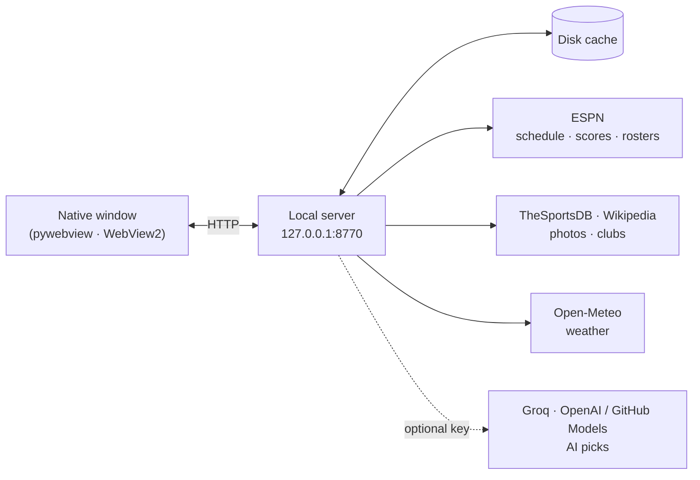

<p align="right"><b>English</b> · <a href="README.ko.md">한국어</a> · <a href="README.zh.md">中文</a> · <a href="README.ja.md">日本語</a></p>

# World Cup Pilot

**A desktop FIFA World Cup viewer with its own prediction engine.** Schedule, results, standings, brackets, players and videos from free public sources, plus **Elo × Score predictions**, **AI predictions** and a **prediction accuracy board**. Every past World Cup (1930–2026) can be browsed by edition. Windows only.

> **Unofficial fan project.** It is not affiliated with, endorsed by or connected to FIFA, ESPN or any data provider. "FIFA" and "World Cup" belong to their owners. This repository contains no third-party data, photos or logos: everything is downloaded on your own PC at first run. For personal use, not for commercial distribution.

## Features

| Area | What you get |
|---|---|
| **Schedule & results** | All matches with live scores, local venue time, events (goals, cards), stats and lineups |
| **Groups** | Live group tables, qualification marks, the 2026 format (top 2 + best 8 third-placed teams) |
| **Predictions** | Win/draw/loss probability and expected score for every match (🔮 Elo × Score) |
| **AI predictions** | ⚡ Groq (Llama 3.3) and 💬 ChatGPT picks, optional |
| **Accuracy** | Grades four predictors against real results: Elo × Score, DraftKings odds, Groq, ChatGPT |
| **Lineups** | Predicted XI before the official list, the real XI and formation after it |
| **History** | Pick any past World Cup; players, ages and rankings are shown as they were then |
| **UI** | Dark and light themes, 4 languages, desktop notifications, taskbar LIVE badge |

## How it works



Data that can no longer change (finished matches, past tournaments) is cached forever, and live data is only requested when it can actually change, so the app stays quick and gentle on the free services.

## Data sources

All free and without a key, except the optional AI picks.

| Data | Source |
|---|---|
| Schedule, scores, standings, brackets, teams, odds, rosters | ESPN |
| Player photos and clubs | TheSportsDB, then Wikipedia as a fallback |
| Flags | flagcdn |
| Stadium images, past emblems | Wikipedia |
| Temperature, humidity, wind | Open-Meteo |
| Highlight videos | YouTube (official FIFA channel first) |
| AI predictions | Groq (free key) and OpenAI or GitHub Models (optional) |

## Prediction (🔮 Elo × Score)

Uses only information available before kickoff. The weights can be adjusted with sliders in the UI.

| Factor | How it counts |
|---|---|
| **Elo** | Seeded from the FIFA ranking, updated with tournament results |
| **Recent form** | Attack, midfield, defence and goalkeeper, recent matches weighted more |
| **Injuries and suspensions** | Weighted by player rating, so a key absentee hurts more |
| **FIFA card rules** | Two yellows mean a one-match ban, a red means a ban, single yellows are cleared after the quarter-finals |
| **Real lineup** | Once the starting XI is published, strength is corrected by the players who actually start |
| **Home, rest, travel, weather** | Home advantage, rest days, travel distance, weather |

**Self-tuning:** the ↻ button grid-searches the model shape on nine tournaments' real results and saves it to `model_params.json`. It only re-tunes when new results exist.

## Download

Get `WorldCupPilot.exe` from **[Releases](https://github.com/dongliquan/WorldCup_Pilot/releases/latest)**. It needs Windows 10 or 11 with the Edge WebView2 runtime.

The exe is not code-signed, so Windows SmartScreen shows a warning: click **More info → Run anyway**. The first launch downloads the data it needs and is slower; later launches are fast.

## Run from source

```bash
python -m venv .venv
.venv\Scripts\pip install -r requirements.txt
.venv\Scripts\python worldcup.py        # the desktop window
python server.py                        # the server only: http://127.0.0.1:8770
pyinstaller --noconfirm worldcup_win.spec   # build dist\WorldCupPilot.exe
```

## Settings (`config.json`)

Copy `config.example.json` to `config.json`. **AI keys are optional**; without them the Elo × Score and DraftKings predictions still work. `config.json` is git-ignored: never commit your keys.

| Key | Meaning |
|---|---|
| `groq_api_key` | Free key from `console.groq.com` (`gsk_…`) |
| `openai_api_key` | OpenAI key (`sk-…`) or a GitHub token (`ghp_…`) for free GitHub Models |
| `competition`, `season` | Default `WC`, `2026` |
| `cache_ttl_seconds` | Short cache for live data (default 60). Static data, finished matches and predictions are cached permanently |
| `venue_timezone` | Fallback time zone, default `America/New_York` |

Restart the app after changing keys.

## Local API

`GET`: `/api/status` · `/api/matches[?year=]` · `/api/standings[?year=]` · `/api/team?id=` · `/api/match?id=` · `/api/predict?id=` · `/api/lineup?id=` · `/api/aipick?id=&p=groq|openai` · `/api/accuracy` · `/api/model-params`
`POST`: `/api/refresh` (revalidate data and re-tune the model) · `/api/grade-ai` · `/api/save-edition?year=`

## Project layout

| File | Role |
|---|---|
| `worldcup.py` | Launcher: starts the server thread and the native window, notifications, taskbar badge |
| `server.py` | Local server: proxies and normalises the sources, caches, predicts, tunes |
| `worldcup.html` | The single-page UI |
| `assets/` | Static data (rankings, country info, venues, editions) and the app icon |
| `test_model_consistency.py` | Checks the prediction math agrees across the UI, server and tuning scripts |
| `worldcup_win.spec` | PyInstaller build for the single Windows exe |

## Known limits

- Windows only. The exe is unsigned.
- The free sources have rate limits (TheSportsDB especially), so photos fill in gradually.
- Data comes from unofficial public endpoints that can change or disappear without notice.

## Privacy and security

No telemetry. The server listens on `127.0.0.1` only. The app calls the public services listed above from your PC, and your AI keys stay in your local `config.json` and are sent only to the matching AI provider. Report vulnerabilities privately through GitHub's *Report a vulnerability* button (see [SECURITY.md](SECURITY.md)).

## License

[MIT](LICENSE) © dongliquan
