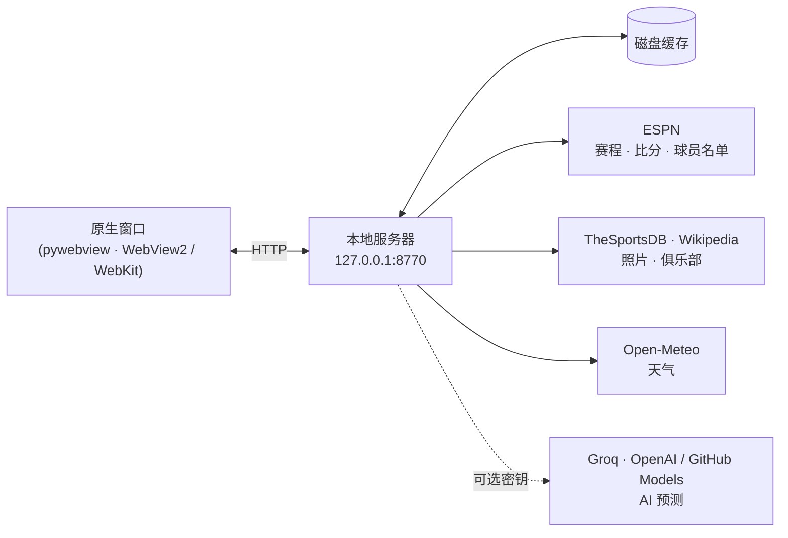

<p align="right"><a href="README.md">English</a> · <a href="README.ko.md">한국어</a> · <b>中文</b> · <a href="README.ja.md">日本語</a></p>

# World Cup Pilot

**自带预测引擎的 FIFA 世界杯桌面查看器。** 使用免费公开数据源展示赛程、结果、积分榜、对阵、球员和视频，并提供 **Elo × Score 预测**、**AI 预测**和**预测准确率对比**。可按届次浏览**历届世界杯（1930–2026）**。支持 Windows 和 macOS。

> **非官方粉丝项目。** 与 FIFA、ESPN 及任何数据提供方均无隶属、赞助或关联。“FIFA”和“World Cup”的权利归各自所有者。本仓库不包含任何第三方数据、照片或标志：所有内容都在你自己的电脑上首次运行时下载。仅供个人使用，不用于商业发布。

## 功能

| 领域 | 内容 |
|---|---|
| **赛程与结果** | 全部比赛的实时比分、当地时间、事件（进球、红黄牌）、技术统计、阵容 |
| **小组赛** | 实时小组积分榜、出线标记、2026 赛制（各组前 2 名 + 成绩最好的 8 个第三名） |
| **预测** | 每场比赛的胜/平/负概率和预计比分（🔮 Elo × Score） |
| **AI 预测** | ⚡ Groq（Llama 3.3）与 💬 ChatGPT 预测（可选） |
| **预测成绩** | 用真实结果给四种预测打分：Elo × Score、DraftKings 赔率、Groq、ChatGPT |
| **阵容** | 官方名单公布前显示预测首发，公布后显示真实首发与阵型 |
| **历届赛事** | 选择任一届，球员、年龄和排名都按当时的情况显示 |
| **界面** | 深色/浅色主题、4 种语言、桌面通知、LIVE 徽标（Windows 为任务栏） |

## 工作原理



不会再变化的数据（已结束的比赛、往届赛事）永久缓存，实时数据只在可能变化时才请求，因此应用很快，也不会给免费服务增加负担。

## 数据来源

除可选的 AI 预测外，全部免费且无需密钥。

| 数据 | 来源 |
|---|---|
| 赛程、比分、积分榜、对阵、球队、赔率、球员名单 | ESPN |
| 球员照片与俱乐部 | TheSportsDB，失败时用 Wikipedia |
| 国旗 | flagcdn |
| 球场图片、往届会徽 | Wikipedia |
| 温度、湿度、风速 | Open-Meteo |
| 集锦视频 | YouTube（优先 FIFA 官方频道） |
| AI 预测 | Groq（免费密钥）、OpenAI 或 GitHub Models（可选） |

## 预测（🔮 Elo × Score）

只使用开球前可获得的信息。权重可通过界面滑块调整。

| 因素 | 计算方式 |
|---|---|
| **Elo** | 以 FIFA 排名为起点，随赛事结果更新 |
| **近期状态** | 进攻、中场、防守、门将四项，越近的比赛权重越大 |
| **伤停** | 按球员评分加权，核心球员缺阵影响更大 |
| **FIFA 红黄牌规则** | 两张黄牌停赛一场，红牌停赛，单张黄牌在 1/4 决赛结束后清零 |
| **真实阵容** | 首发名单公布后，按实际出场球员校正实力 |
| **主场、休息、旅途、天气** | 主场优势、休息天数、旅行距离、天气 |

**自我调优：** ↻ 按钮会用九届世界杯的真实结果对模型形状做网格搜索，并保存到 `model_params.json`。只有出现新结果时才会重新调优。

## 下载

请从 **[Releases](https://github.com/dongliquan/WorldCup_Pilot/releases/latest)** 下载适合你系统的版本。

| 系统 | 文件 | 要求 |
|---|---|---|
| Windows 10 / 11 | `WorldCupPilot.exe` | Edge WebView2 运行时 |
| macOS，Apple Silicon | `WorldCupPilot-mac-arm64.dmg` | macOS 11 或更高 |
| macOS，Intel | `WorldCupPilot-mac-x86_64.dmg` | macOS 11 或更高 |

目前尚未做代码签名，首次启动会出现警告：

- **Windows：** SmartScreen 提示“Windows 已保护你的电脑”，点击**更多信息 → 仍要运行**。
- **macOS：** 把应用拖到“应用程序”，右键点击并选择**打开**，再点一次**打开**；或运行 `xattr -dr com.apple.quarantine "/Applications/World Cup Pilot.app"`。

首次启动需要下载所需数据，速度较慢，之后会很快。

## 从源码运行

**Windows**

```bash
python -m venv .venv
.venv\Scripts\pip install -r requirements.txt
.venv\Scripts\python worldcup.py          # 桌面窗口
pyinstaller --noconfirm worldcup_win.spec   # 构建 dist\WorldCupPilot.exe
```

**macOS**

```bash
python3 -m venv .venv
.venv/bin/pip install -r requirements.txt
.venv/bin/python worldcup.py                # 桌面窗口
./build_mac.sh                              # 构建 dist/World Cup Pilot.app 和 .dmg
```

两个系统上都可以只运行服务器：`python server.py` → http://127.0.0.1:8770

## 设置（`config.json`）

把 `config.example.json` 复制为 `config.json`。**AI 密钥是可选的**，没有密钥时 Elo × Score 和 DraftKings 预测仍可使用。`config.json` 已被 git 忽略，请绝不要提交你的密钥。

| 键 | 含义 |
|---|---|
| `groq_api_key` | `console.groq.com` 的免费密钥（`gsk_…`） |
| `openai_api_key` | OpenAI 密钥（`sk-…`），或用于免费 GitHub Models 的 GitHub 令牌（`ghp_…`） |
| `competition`, `season` | 默认 `WC`、`2026` |
| `cache_ttl_seconds` | 实时数据的短缓存（默认 60）。静态数据、已结束的比赛和预测永久缓存 |
| `venue_timezone` | 备用时区，默认 `America/New_York` |

修改密钥后需要重启应用。

## 本地 API

`GET`：`/api/status` · `/api/matches[?year=]` · `/api/standings[?year=]` · `/api/team?id=` · `/api/match?id=` · `/api/predict?id=` · `/api/lineup?id=` · `/api/aipick?id=&p=groq|openai` · `/api/accuracy` · `/api/model-params`
`POST`：`/api/refresh`（重新校验数据并重新调优模型）· `/api/grade-ai` · `/api/save-edition?year=`

## 项目结构

| 文件 | 作用 |
|---|---|
| `worldcup.py` | 启动器：启动服务器线程和原生窗口，处理通知与任务栏徽标 |
| `server.py` | 本地服务器：代理并规范化各数据源，负责缓存、预测、调优 |
| `worldcup.html` | 单页界面 |
| `assets/` | 静态数据（排名、国家信息、球场、赛事信息）和应用图标 |
| `test_model_consistency.py` | 检查界面、服务器与调优脚本中的预测公式是否一致 |
| `worldcup_win.spec` | 构建 Windows 单文件 exe 的 PyInstaller 配置 |
| `worldcup_mac.spec`, `build_mac.sh` | 构建 macOS `.app` 和 `.dmg` |

## 已知限制

- 仅支持 Windows 和 macOS，构建未做代码签名。
- macOS 没有任务栏徽标，由应用内的 LIVE 标记显示正在进行的比赛。
- 免费数据源有调用限额（尤其是 TheSportsDB），照片会逐步补全。
- 数据来自非官方的公开接口，可能在没有通知的情况下变化或消失。

## 隐私与安全

没有遥测。服务器只监听 `127.0.0.1`。应用在你的电脑上直接调用上述公开服务，AI 密钥只保存在你本地的 `config.json` 中，并且只发送给对应的 AI 提供方。请通过 GitHub 的 *Report a vulnerability* 私下报告漏洞（见 [SECURITY.md](SECURITY.md)）。

## 许可证

[MIT](LICENSE) © dongliquan
